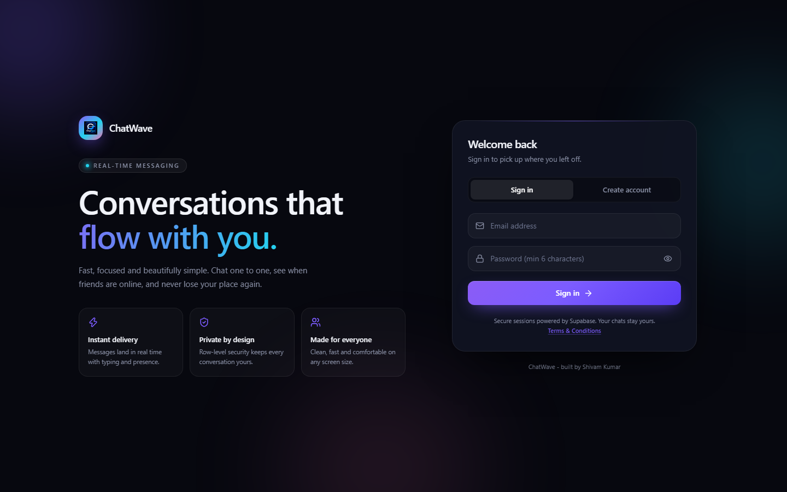

# ChatWave

A polished, real-time chat application built with React, Vite, Tailwind CSS and Supabase. It ships with a responsive dark interface, authentication, live messaging, presence, read receipts, attachments and a full set of message actions.



*ChatWave sign-in page — clean, responsive and focused on the conversation.*

## Features

- **Authentication** — email/password sign up and sign in powered by Supabase Auth, with a password-strength indicator and protected app routes.
- **Real-time messaging** — instant 1:1 conversations using Supabase Realtime.
- **Contacts & new chats** — pick a contact to start a conversation; duplicate direct chats are prevented by a database function.
- **Presence** — online status and last-seen information, plus typing indicators.
- **Read receipts & unread counts** — per-conversation read state, unread badges and an unread count in the browser tab title.
- **Rich messages** — emoji picker, emoji rendering, reply threads, reactions and forwarded messages.
- **Attachments** — image uploads (up to 5 MB) and file uploads (up to 25 MB) via Supabase Storage, with captions and file details.
- **Message actions** — edit, delete (for you / for everyone), star, forward, pin and archive.
- **Profiles** — display name, avatar colour, uploaded avatar photo and a bio/about section.
- **Notifications** — optional notification sounds and browser desktop notifications.
- **Comfort controls** — sound toggle and reduced-motion support, stored in local storage.
- **Responsive UI** — glassy dark theme that works on desktop and mobile.

## Tech stack

| Layer | Technology |
| --- | --- |
| UI | React 19, Tailwind CSS 4 |
| Build tool | Vite 8 |
| Backend / Database | Supabase (Postgres, Auth, Storage, Realtime) |
| Icons | Lucide React |
| Linting | Oxlint |

## Getting started

### 1. Install dependencies

```bash
npm install
```

### 2. Configure environment

Copy `.env.example` to `.env` and fill in your Supabase project values:

```env
VITE_SUPABASE_URL=https://your-project.supabase.co
VITE_SUPABASE_ANON_KEY=your-anon-key
```

You can find both values in **Supabase Dashboard → Project Settings → API**. Never commit `.env` — it is already ignored by Git.

### 3. Set up the database

Create a Supabase project, then open **SQL Editor** and run the SQL files in `supabase/` in this exact order:

| File | What it adds |
| --- | --- |
| `schema.sql` | Base schema: profiles, conversations, members, messages, RLS policies, triggers and Realtime publication |
| `schema2.sql` | Presence, typing indicators, read receipts and unread counts |
| `schema3.sql` | Duplicate-direct-chat prevention helper |
| `schema4.sql` | Avatar uploads (`avatars` bucket) and profile Realtime |
| `schema5.sql` | Image attachments (`chat-images` bucket) |
| `schema6.sql` | Replies, reactions and the forwarded flag |
| `schema7.sql` | Profile bio/about field |
| `schema8.sql` | Edit/delete actions, reaction policies and file attachments (`chat-files` bucket) |

Each migration is idempotent where possible (`if not exists` / `drop policy if exists`), so re-running one is safe. Make sure email/password sign-in is enabled in **Authentication → Providers**.

### 4. Run the app

```bash
npm run dev
```

Open the local URL printed by Vite. Build and lint with:

```bash
npm run build
npm run lint
```

## Project structure

```text
src/
├── components/     UI components (sidebar, chat window, composer, modals, bubbles, avatar…)
├── context/        AuthContext — Supabase auth state
├── hooks/          Chats, presence, typing, notifications and sound hooks
├── lib/            Supabase client and sound helpers
├── pages/          AuthScreen
├── App.jsx         App shell, chat state and all message actions
├── index.css       Tailwind theme and global styles
└── main.jsx        React entry point
supabase/           SQL migrations (schema.sql → schema8.sql)
public/             Logo, favicon and icons
docs/               Screenshots used in this README
```

## Security notes

- Only `VITE_SUPABASE_URL` and the **anon** key belong in the frontend. Row Level Security (RLS) in the SQL migrations controls what authenticated users may read and write.
- Never expose a `service_role` key in client code or in `.env` files that get committed.
- Keep `.env` local and use `.env.example` to document the required variables.

## Scripts

| Command | Description |
| --- | --- |
| `npm run dev` | Start the Vite development server |
| `npm run build` | Create a production build in `dist/` |
| `npm run preview` | Preview the production build locally |
| `npm run lint` | Run Oxlint over the source |
